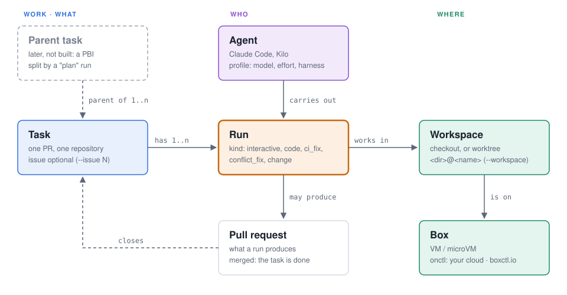

# Shared vocabulary: Task, Agent, Run, Workspace, Box

Status: proposal, for review. The same file is in `cdalar/onctl` and
`boxctl-io/boxctl-cli`. Keep the two copies identical.

## Why

onctl and boxctl are the same tool. The only difference is where a box
comes from: with onctl it's your own cloud account, with boxctl it's
boxctl.io. Both have grown words that mean several things at once:

- **session** means five things: a box with a project on it
  (`agentSession`), a worktree with its multiplexer session
  (`taskSession`), a herdr workspace, a tmux/herdr session, and a Claude
  Code session.
- **task** means two things: the worktree `--task auth` makes (a place)
  and, in the agents view and the backlog, the work Claude is given (a
  job).
- **run** means four things in boxctl: `backlog.Run`, `goalRun`, an
  ephemeral run and a `--repo` run. Interactive sessions aren't runs at
  all, so `boxctl runs` and `boxctl claude ls` each show part of the
  picture.
- **backlog item**, **goal** and **issue** are three ways into the same
  thing (one repository, one pull request), and nothing links an item to
  the issue it came from.
- onctl's `:agents` view lists boxes, not agents.

## The words

| Word | Means | Isn't |
|---|---|---|
| **Task** | One piece of work that ends in one pull request, in one repository. In the backlog it is an issue on the forge (Azure DevOps: a work item). A one-off run's task is just its text. | A place. A group of tasks. |
| **Agent** | What does the work: Claude Code or Kilo, with its model, effort and harness (its *profile*). It has no state of its own. | A running process or a box. |
| **Run** | One agent working once, in one workspace, interactive or unattended. It has a kind, a status (working, blocked, done, failed, lost, killed) and, when it gets that far, a pull request. A task has one or more runs. | The task itself. |
| **Workspace** | Where a run's code is: a checkout of the project on a box, or a git worktree beside it (`<dir>@<name>`, branch `<name>`). | The box. |
| **Box** | A machine: a VM or microVM. It holds one or more workspaces. onctl makes it in your cloud, boxctl gets it from boxctl.io. | A workspace or an environment. |
| **Backlog** | The forge's issues labelled for onctl, worked through a few at a time, in the order of their priority labels. | A layer above tasks. |

Relations: a task has 1..n runs; a run is carried out by one agent, in one
workspace; a workspace is on one box; a box holds 1..n workspaces; a run
may produce a pull request; merging it closes the task (and its issue,
when it has one).

Run kinds: `interactive` (someone attached, today's sessions), `code` (a
new branch, ending in a pull request), and the follow-ups on that pull
request's branch: `ci_fix`, `conflict_fix`, `change`.

Implementation details keep their own names and stay out of user-facing
text: the multiplexer session (tmux or herdr) a run lives in, herdr's
workspaces, Claude Code's session ID (`--handoff`).

## Decisions

1. **No layer above Task for now.** A bigger piece of work (a "PBI") is
   not modelled. Independent tasks already run in parallel (`boxctl
   backlog limit`); what splitting work would add is ordering and
   dependencies between tasks, which nothing does today.
2. **A backlog task is an issue; a one-off run's task is text.** The
   backlog keeps no store of its own (see
   [control-plane.md](https://github.com/cdalar/onctl/blob/main/docs/plans/control-plane.md)). `--issue N` runs issue
   N, and its pull request closes it.
3. **The new names are user-facing, with no aliases.** There are no users
   to keep working yet, so old flags and views go away in the same
   change that adds the new ones. Callers inside the repositories (the
   Claude plugins, `backlog dispatch`, docs, tests) change in that same
   change too.

## Renames

### Both

| Today | New |
|---|---|
| `claude --task <name>` (a worktree) | `claude --workspace <name>` |
| `claude --own-box` ("with --task") | `claude --own-box` ("with --workspace") |
| `claude ls`: "sessions", "tasks" | `claude ls`: workspaces and their runs |
| `taskSession`, `taskDir` | `workspace`, `workspaceDir` |

### onctl

| Today | New |
|---|---|
| tui `:agents` | tui `:runs` |
| `agentSession` | `run` |
| the prompt text the agents view sends ("every task") | a task's description |

### boxctl

| Today | New |
|---|---|
| `backlog.Item`, `Item.Goal`, `~/.boxctl/backlog.json` | an issue and its text; no file (control-plane.md, step 4) |
| `boxctl backlog add <goal>` | `backlog add <description>`: opens an issue labelled queued |
| `claude --goal "<text>"` | `claude --task "<text>"` (freed by `--workspace`) |
| `claude --issue N` | unchanged |
| `goalRun`, ephemeral run, `--repo` run, `backlog.Run` | one `Run`, with a kind |
| `boxctl runs`: backlog runs only | `boxctl runs`: every run |
| `--harness`, `--model`, `--effort` | unchanged flags; together called the agent's profile in docs |

`--task` changing meaning (worktree name → work description) is the one
rename that can trip someone with old habits. It lands with
`--workspace` in one change, so a mistyped `--task auth` becomes an
unattended run with the description "auth": `claude --task` should
refuse a description shorter than a few words to catch that.

## Out of scope

- `onctl env` (infrastructure from a template) keeps its name; it isn't
  part of this model, and its docs shouldn't call a box an environment.
- `boxctl board` / `boxctl tui` and the tui's home split stay as they
  are.

## Later: a layer above Task

When tasks are often entered by hand as parts of one bigger piece of
work, or need "this one first", add it without a new kind of record:

- A task gets an optional `parent` task.
- Splitting is a run kind, `plan`, whose output is new tasks instead of
  a pull request.
- On GitHub the parent is an issue with sub-issues, so "a task is an
  issue" still holds.

## Order of work

One pull request per repository, each doing all of its renames, with
tests updated to the new names:

1. boxctl-cli: `--goal` → `--task`, `--task` →
   `--workspace`, one `Run`, `boxctl runs` for every run, the Claude
   plugin and docs.
2. onctl: `--task` → `--workspace`, `:agents` → `:runs`, `agentSession`
   → `run`, the onctl plugin and docs.
